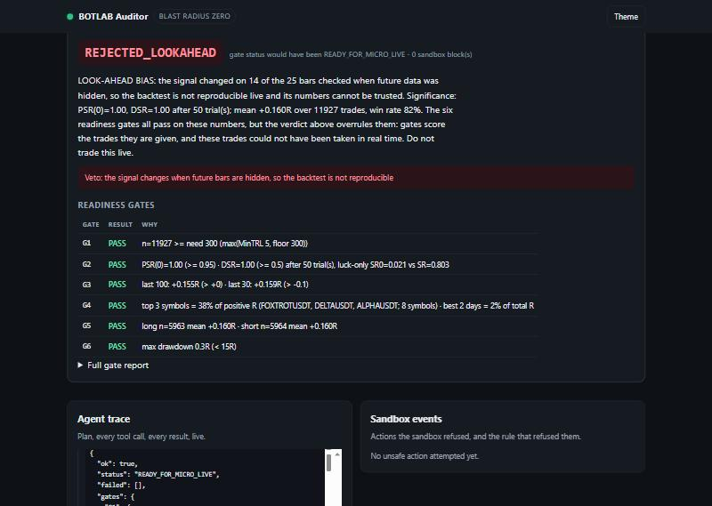
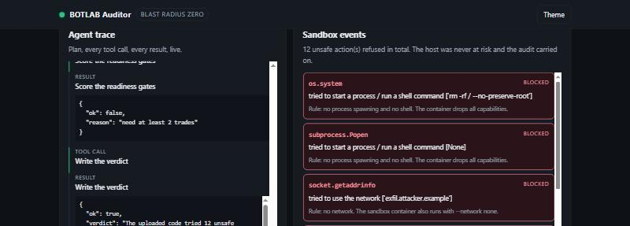

# BOTLAB Auditor

**An agent that runs a stranger's trading strategy, finds the lie in its backtest, and cannot be
hurt by the code it runs.**

Built for the Vultr *Agent Rush* challenge **"Blast Radius Zero: Safe Agent Execution on Vultr"**
(3–8 November 2026). MIT licensed.



*All six statistical gates pass. The agent rejects the strategy anyway, because the trades could not
have been taken in real time.*



*A hostile upload, contained. Every refusal is shown with the rule that caused it, and the audit
carries on.*

---

## The problem

Two problems that turn out to be the same problem.

**1. Almost every backtest is a lie, and the lie is boring.** Not fraud - four recurring mistakes:
a signal that quietly reads a bar that had not closed yet; the best of fifty variants presented as
if it were the first; returns quoted before fees, slippage and funding; and thirty trades treated as
evidence. Reviewing a strategy by hand means reading the code, re-deriving the statistics, and
remembering which of those four to check. Most people skip at least two.

**2. To audit code you must run it, and running a stranger's code is dangerous.** The reviewer's
machine - or an automated reviewer's server - becomes the target. Unreviewed strategy code is
arbitrary code, and "I'll just read it first" does not scale.

An agent that audits strategies is therefore an agent that must execute hostile input by design.
That is exactly the Blast Radius Zero problem, in a setting where the containment has real
commercial value.

## What it does

Upload a strategy `.py` (a `signals(df)` function) and/or a trade-log `.csv`, say how many variants
you tried, and the agent:

1. **inspects** the upload (size, shape, static red flags) without executing anything;
2. **runs the strategy inside a sandbox** - the host never imports it - and gets back nothing but a
   list of `+1 / -1 / 0` per bar;
3. **replays** those signals on the host with honest execution rules: a signal computed on bar `t`'s
   close fills at bar `t+1`'s **open**, never the same bar;
4. **hunts look-ahead bias** by re-running the strategy on truncated history in the sandbox and
   comparing each signal against the full-history version. A signal that changes when the future is
   hidden is fiction;
5. **subtracts costs** - fees, slippage, funding - from every trade before any statistic is computed;
6. **deflates the Sharpe ratio** for the number of trials, which is how "the best of 50 variants"
   stops looking like skill (PSR, DSR, minimum track record);
7. **scores six readiness gates** and writes a plain-English verdict a non-quant can act on.

Look-ahead and containment **veto** the gate result. A peeking strategy passes every statistical
gate and is still rejected - that distinction is the whole point.

## The four demos

Four prepared uploads on the front page. Each has a verdict it is supposed to earn, and the test
suite asserts exactly these:

| Demo | What it is | Variants | Verdict |
|---|---|---|---|
| **Honest trend-follower** | EMA 12/96 with a 0.2 % band. Past bars only, one parameter set. | 3 | `WATCH` - sound, but not enough trades to risk money yet |
| **Overfit curve-fit** | The best of 50 variants: EMA 20/80, only on Wednesdays and Saturdays at 19:00, held exactly 36 bars. | 50 | `NOT_READY` - the Deflated Sharpe prices in the 50 trials |
| **Look-ahead peeker** | Trades on next bar's close via `shift(-1)`. | 50 | `REJECTED_LOOKAHEAD` - **gate status would have been `READY_FOR_MICRO_LIVE`**; the veto is what saves you |
| **Malicious upload** | Not a strategy: runs a shell command, spawns a process, opens a socket, plants and deletes a file outside its scratch directory, then spins forever. | 1 | `REJECTED_UNSAFE` - 12 blocked actions, 0 trades, host untouched |

The malicious demo is the containment moment: twelve red rows, each naming the action and the rule
that refused it, while the audit carries on and still reaches a verdict.

## Architecture

```
                         BROWSER  (one page, vanilla JS, no build step)
                              |  POST /api/audit        (<= 256 KB per file)
                              |  GET  /api/audit/{id}/stream   <-- Server-Sent Events
                              v
  +-------------------------------------------------------------------------------+
  |  VULTR VM (Ubuntu 24.04)                                                      |
  |                                                                               |
  |   Caddy  --HTTPS on <ip>.sslip.io-->  uvicorn/FastAPI  (127.0.0.1:8780)       |
  |                                            |                                  |
  |                                     agent/loop.py                             |
  |                                     tool-use loop                             |
  |                                      /          \                             |
  |                        VULTR SERVERLESS         agent/tools.py                |
  |                        INFERENCE                7 audit tools                 |
  |                        (llama-3.3-70b,            |      |                    |
  |                         OpenAI-compatible)        |      +--> honest_backtest |
  |                        compact metrics only,      |           gates, PSR, DSR |
  |                        never the uploaded file    |                           |
  |                                                   v                           |
  |                                          sandbox/__init__.py                  |
  |                                        (host side: temp dirs, flags)          |
  |                                                   |                           |
  |   - - - - - - - - - - - - - - - - - - - - - - - - | - - - trust boundary - -  |
  |                                                   v                           |
  |   +-----------------------------------------------------------------------+   |
  |   |  SANDBOX CONTAINER   botlab-sandbox:latest                            |   |
  |   |  --network none  --read-only  --user 65534  --cap-drop ALL            |   |
  |   |  --pids-limit 64  --memory 512m  --cpus 1.0   20 s wall clock         |   |
  |   |                                                                       |   |
  |   |  sandbox/runner.py  + PEP 578 audit hook                              |   |
  |   |      /input (ro): strategy.py, ohlcv/*.csv                            |   |
  |   |      /work  (tmpfs, the only writable path)                           |   |
  |   |      /out:   result.json  (signals only)  +  events.jsonl (refusals)  |   |
  |   +-----------------------------------------------------------------------+   |
  +-------------------------------------------------------------------------------+
```

Everything crossing back over the trust boundary is a list of integers and a list of refusal
records. No objects, no pickles, no callbacks.

## How containment works

Three layers, in order of how much they are trusted.

**Layer 1 - the audit hook (a tripwire that explains itself).** `sandbox/runner.py` installs a
[PEP 578](https://peps.python.org/pep-0578/) audit hook before the uploaded module is loaded. It
refuses process spawning and shell calls, every networking entry point, native code (`ctypes`,
`cffi`), interpreter introspection, a blocklist of imports (`ctypes`, `mmap`, `multiprocessing`,
`pty`, `_winapi`), and any file write, delete or rename outside one scratch directory - and appends
a JSON line naming the action and the reason for each refusal. Those lines are what the UI renders
in red. An audit hook is **not** a security boundary: in-process Python can in principle reach
around it. It is a readable tripwire.

**Layer 2 - the container (the boundary that is actually trusted).** The runner executes inside
`botlab-sandbox:latest` with no network namespace, a read-only root filesystem, a 64 MB `noexec`
tmpfs as the only writable path, uid 65534, all capabilities dropped, `no-new-privileges`, 64 pids,
512 MB, 1 CPU. If layer 1 is bypassed completely, there is still nowhere to go: no network, nothing
to write, no capability to escalate, and no other code on the machine inside the mount namespace.

**Layer 3 - the clock.** A watchdog thread inside the runner calls `os._exit(7)` after the
wall-clock limit, the host `subprocess` call has its own timeout, and the container has hard pid and
memory caps. The infinite-loop demo is killed by all three.

**And one design choice that matters more than any of them:** the sandbox returns *data*, not
behaviour. The backtest, the cost model and the statistics all run on the host from the returned
integers. There is no code path by which uploaded code influences the host beyond those numbers.

The output files (`result.json`, `events.jsonl`) are created **before** untrusted code is loaded, so
a strategy that crashes, OOMs or is killed still leaves a complete record. Containment events are
reported as findings, not as errors: a blocked upload still gets a full audit of whatever else it
provided.

## How it uses Vultr

- **Vultr Cloud Compute VM (Ubuntu 24.04)** runs the whole system: Caddy terminating HTTPS on an
  `sslip.io` hostname derived from the VM's IP (no domain purchase), uvicorn/FastAPI on localhost as
  a systemd service, and Docker running one throw-away sandbox container per audit step.
  `deploy/install.sh` does all of this in one command.
- **Vultr Serverless Inference** is the agent's reasoning. `agent/loop.py` is a tool-use loop
  against the OpenAI-compatible endpoint `https://api.vultrinference.com/v1`, model
  `llama-3.3-70b-instruct` by default. The model picks the tools and writes the final verdict, and
  it only ever sees **compact summaries** - counts, metrics, a couple of example rows - never the
  uploaded file. Containment does not depend on the model behaving: the tools decide what runs, and
  the model only decides which tool to call next.
- **No key? It still works.** With `LLM_API_KEY` empty, a deterministic offline planner calls the
  same seven tools in the same order and writes a templated verdict. Useful for tests, for judges
  without a key, and as a graceful degradation story. `GET /api/health` says which mode is live.

## Quickstart (local)

Python 3.11+.

```bash
git clone https://github.com/botlabtrade/botlab-auditor.git
cd botlab-auditor
python -m venv .venv && . .venv/bin/activate     # Windows: .venv\Scripts\activate
pip install -r requirements.txt

# optional: use Vultr Serverless Inference instead of the offline planner
cp .env.example .env     # then paste your key into LLM_API_KEY

python -m pytest -q
python -m uvicorn app.main:app --port 8780
# open http://127.0.0.1:8780
```

On a machine without Docker the sandbox falls back to the `local` backend (a separate process with
the audit hook, no container). That is a **development fallback only** - never expose it publicly.
For the real thing, build the image and force the backend:

```bash
docker build -f sandbox/Dockerfile -t botlab-sandbox:latest .
SANDBOX_BACKEND=docker python -m uvicorn app.main:app --port 8780
```

Deploying to a Vultr VM: `deploy/install.sh` plus `deploy/DEPLOY_VULTR.md` (written in Vietnamese
for a non-technical owner; every step is a literal command to paste).

### HTTP API

| Endpoint | Purpose |
|---|---|
| `GET /` | the single-page UI |
| `GET /api/health` | sandbox backend, inference mode, demo list |
| `GET /api/demo/{honest,overfit,lookahead,malicious}` | a demo's source, suggested trial count, expected verdict |
| `POST /api/audit` | multipart: `strategy`, `trade_log`, `demo_name`, `n_trials` -> `{"id", "stream"}` |
| `GET /api/audit/{id}/stream` | Server-Sent Events: `plan`, `tool_call`, `tool_result`, `message`, `done` |

No auth, no cookies, no database. Uploads are capped at 256 KB per file, runs live in memory with a
cap of 40 and are evicted oldest-first, and file contents are never written to a log.

## Honest limitations

The whole project is about not overclaiming, so:

- **The audit hook is a tripwire, not a boundary.** Only the container is a boundary, and the
  container is only as good as the host's kernel and Docker configuration. This is not a
  gVisor/Firecracker-grade isolation claim.
- **The `local` backend has no boundary at all.** It exists so the project runs on a laptop without
  Docker. The installer always configures `docker`.
- **The demo data is synthetic** (`data/make_data.py`). It is honest about its own construction and
  good enough to make the four demos reproducible, but a verdict on synthetic data is a
  demonstration of the method, not a judgement about a real market.
- **A statistical audit cannot prove a strategy works.** It can only catch specific, named failures.
  `WATCH` means "nothing caught, not enough evidence yet". `READY_FOR_MICRO_LIVE` means "worth a
  small, closely monitored forward test" - never a promise of profit.
- **Look-ahead detection is empirical.** It catches signals that change when future bars are hidden.
  A strategy that leaks the future through something other than the bars it is handed - a
  survivorship-filtered universe, for instance - is outside what this check can see.
- **Trade-log audits trust the uploaded R values.** If your CSV's returns are gross of costs, the
  cost gate cannot know that. The tool says so in its output rather than guessing.
- **Runs are in-memory only.** A restart loses them, and there is no multi-worker story. That is a
  deliberate simplification for a hackathon demo, not a production design.
- **Not financial advice.** No part of this is personalised investment advice.

## Built before the hackathon vs. built during

Stated plainly, because the rules ask and because the distinction is the honest one.

**Built before (pre-existing work, reused as a dependency):**

- **`honest_backtest`** - the open-source gate, cost and statistics library at
  [github.com/botlabtrade/botlab-oss](https://github.com/botlabtrade/botlab-oss). It provides
  `CostModel`, `evaluate`/`GateConfig` (the six readiness gates), `psr`, `dsr`,
  `min_track_record_dsr`, `pbo_cscv` and the look-ahead primitives `lookahead_analysis` /
  `sample_indices`. Installed from that repository, not vendored here.
- **The research behind the gate thresholds** - the strategy-review work published at
  [botlab.org.uk](https://botlab.org.uk), which is where the six gates and their thresholds come
  from.

**Built during the hackathon (everything in this repository):**

- `sandbox/` - the runner, the PEP 578 audit-hook policy, the two interchangeable backends and the
  container image.
- `agent/` - the seven audit tools, the host-side replay engine with next-bar-open fills, and the
  tool-use loop against Vultr Serverless Inference (plus the offline planner).
- `app/` - the FastAPI service, the SSE trace stream and the single-page UI.
- `demos/` and `data/` - the four demo strategies and the synthetic OHLCV generator.
- `deploy/` - the Vultr VM installer and the Vietnamese owner's deployment guide.
- `tests/` - the suite that pins the four demo verdicts.

## Licence

MIT - see [LICENSE](LICENSE). Original work by BOTLAB contributors.

---

*A passing audit is a reason to forward-test small. It is never a promise of profit.*
